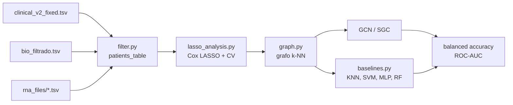

# Predição de Respostas a Tratamentos Oncológicos com Redes Neurais de Grafos

**Similaridade contextual e expressão gênica na predição de desfecho oncológico**

Projeto de Iniciação Científica (PIBIC 2025/2026) — Instituto de Ciências Matemáticas e de Computação (ICMC/USP).


---

## Sumário

- [Sobre o projeto](#sobre-o-projeto)
- [Status e escopo desta branch](#status-e-escopo-desta-branch)
- [Pipeline](#pipeline)
- [Estrutura do repositório](#estrutura-do-repositório)
- [Dados](#dados)
- [Instalação](#instalação)
- [Como usar](#como-usar)
- [Metodologia implementada](#metodologia-implementada)
- [Métricas e protocolo de avaliação](#métricas-e-protocolo-de-avaliação)
- [Resultados de referência](#resultados-de-referência)
- [Limitações e cuidados](#limitações-e-cuidados)
- [Branches experimentais](#branches-experimentais)
- [Reprodutibilidade](#reprodutibilidade)
- [Como contribuir](#como-contribuir)
- [Como citar](#como-citar)
- [Agradecimentos](#agradecimentos)
- [Licença](#licença)
- [Contato](#contato)

---

## Sobre o projeto

A heterogeneidade molecular do câncer torna difícil prever como cada paciente
responderá a um tratamento. Este projeto investiga o uso de **Redes Neurais de
Grafos (GNNs)** para prever desfechos clínicos a partir de perfis de expressão
gênica, representando cada paciente como um vértice de um grafo e conectando
pacientes com perfis moleculares semelhantes.

A motivação central é que a similaridade entre pacientes não depende apenas da
comparação par a par: a estrutura de vizinhança e a concordância entre listas
ranqueadas também carregam informação. O relatório do projeto chama essa ideia
de **similaridade contextual** e a operacionaliza com re-ranqueamento por
*Rank-Biased Overlap* (RBO), ponderação por RBF local e normalização simétrica
da matriz de adjacência.

> **Tarefa implementada neste repositório:** classificação binária do desfecho
> `event` (`0` = sem óbito registrado, `1` = óbito) a partir de expressão
> gênica. A formulação com horizonte fixo de cinco anos e exclusão de pacientes
> censurados está descrita no relatório e implementada nas branches
> experimentais — veja [Status e escopo](#status-e-escopo-desta-branch).

**Referência metodológica:** relatório final de Iniciação Científica
"Predição de Respostas a Tratamentos Oncológicos Utilizando Redes Neurais de
Grafos com Similaridade Contextual" (Caio Capocasali da Silva, orientação do
Prof. Dr. Lucas Pascotti Valem, ICMC/USP). O documento não está versionado
neste repositório.

---

## Status e escopo desta branch

A branch `main` contém uma versão **enxuta e consolidada** do pipeline:

```
expressão gênica → seleção por Cox LASSO → grafo k-NN de pacientes → GCN/SGC
                                                              ↘ baselines clássicos
```

Ela é útil para estudar e executar o núcleo da abordagem, mas **não reproduz
diretamente todos os números do relatório**. O protocolo final descrito no
documento inclui etapas que estão nas branches experimentais:

| Componente do relatório | Na `main`? | Onde está |
|---|---|---|
| Horizonte de 5 anos e exclusão de censurados | Não | `train_test_split` (`few_labels_gnn*.py`) |
| Seleção dos 400 genes mais variáveis | Parcial (limiar de variância + Cox LASSO) | `train_test_split` |
| Similaridade por cosseno | Não (usa distância euclidiana) | `train_test_split` |
| Re-ranqueamento por RBO | Não | `reranking` (versão parcial) e `train_test_split` |
| Pesos por RBF local | Não (usa a distância como peso) | `train_test_split` |
| Normalização simétrica `D^{-1/2} A D^{-1/2}` | Não | `train_test_split` |
| SGC-linear e APPNP-linear | SGC sim; APPNP não | `train_test_split` |
| GCN | Sim | `main` |
| 100 seeds | Não (5 repetições por padrão) | `train_test_split` |
| Grade de `K` e frações de treino | `K` configurável; notebook usa `K=5` | `train_test_split` |

A `main` é, portanto, o ponto de partida documentado; os experimentos
comparativos completos devem ser lidos na branch `train_test_split`.

---

## Pipeline



1. **Montagem da tabela de pacientes** (`filter.py`): junta dados clínicos,
   biospecimen e arquivos de expressão; cada linha final é um paciente.
2. **Seleção de genes** (`lasso_analysis.py`): `log1p`, filtro de variância,
   padronização e Cox LASSO com busca de `alpha` por validação cruzada.
3. **Construção do grafo** (`graph.py`): `k` vizinhos mais próximos no espaço
   dos genes selecionados; cada nó guarda suas features e o desfecho.
4. **Modelagem** (`graph.py` e `baselines.py`): GCN e SGC sobre o grafo, e
   modelos tabulares nos mesmos splits para comparação.
5. **Avaliação**: acurácia balanceada e ROC-AUC, com média e desvio-padrão
   entre seeds.

---

## Estrutura do repositório

```
.
├── main.py                  # notebook marimo que orquestra o pipeline
├── filter.py                # ingestão GDC → patients_table (Parquet)
├── lasso_analysis.py        # seleção de genes com Cox LASSO
├── graph.py                 # grafo k-NN + GCN/SGC + avaliação
├── baselines.py             # KNN, SVM, MLP e Random Forest
├── requirements.txt         # freeze do ambiente usado nos experimentos
├── bio_filtrado.tsv         # biospecimen filtrado (TCGA-BRCA + TARGET-AML)
├── clinical_v2_fixed.tsv    # dados clínicos do GDC
├── rna_files/               # (não versionado) arquivos de expressão
├── patients_table           # (não versionado) Parquet gerado
└── .gitignore
```

| Arquivo | Papel | Principais funções |
|---|---|---|
| `filter.py` | Transforma dados brutos do GDC em uma matriz paciente × gene | `compute_survival_columns`, `find_paths`, `get_rna_exp`, `create_project_map_to_parquet` |
| `lasso_analysis.py` | Seleciona genes associados à sobrevivência | `lasso` |
| `graph.py` | Constrói o grafo e treina/avalia GNNs | `build_patient_knn_graph`, `GCNClassifier`, `SGCClassifier`, `predict_event_gnn` |
| `baselines.py` | Modelos de comparação sem grafo | `predict_event_classical` |
| `main.py` | Encadeia todas as etapas no marimo | células do notebook |

> `__pycache__/` e `__marimo__/` são artefatos de execução. Eles aparecem no
> histórico antigo do repositório, mas não devem ser versionados.

---

## Dados

### Arquivos versionados

| Arquivo | Conteúdo | Tamanho / dimensão |
|---|---|---|
| `bio_filtrado.tsv` | Relação caso → amostra → arquivo de expressão para TCGA-BRCA e TARGET-AML | 3.328 linhas × 60 colunas (~1,2 MB); 3.206 casos únicos; 3.069 amostras com `days_to_diagnosis == 0` |
| `clinical_v2_fixed.tsv` | Metadados clínicos do GDC (demografia, diagnóstico, tratamento, sobrevida) | 20.888 linhas × 1.454 colunas (~42 MB) |

Os números acima foram calculados sobre os arquivos deste repositório e podem
variar ligeiramente em relação ao relatório, que descreve uma versão anterior
da extração (por exemplo, 1.942 casos TARGET-AML e 990 TCGA-BRCA após os
filtros).

### Dados não versionados

| Caminho | Conteúdo | Observação |
|---|---|---|
| `rna_files/` | Matrizes de contagem por gene (STAR-Count do GDC) | ~3 mil arquivos, ~12,9 GB no recorte do projeto |
| `patients_table` | Parquet com uma linha por paciente e uma coluna por gene | Gerado por `filter.py`; centenas de MB |

Como os arquivos de expressão são grandes, eles **não devem ser commitados**.
Se for necessário versionar dados, use [Git LFS](https://git-lfs.com/) ou um
serviço externo (Zenodo, OSF etc.).

### Origem: Genomic Data Commons (GDC)

Os dados vêm do [GDC Data Portal](https://portal.gdc.cancer.gov/), projeto
[TCGA](https://www.cancer.gov/ccg/research/genome-sequencing/tcga). Os filtros
descritos no relatório para obtenção dos arquivos de expressão são:

- Experimental Strategy: **RNA-Seq**
- Data Category: **Transcriptome Profile**
- Data Type: **Gene Expression Quantification**
- Data Format: **TSV**
- Workflow Type: **STAR-Count**
- Platform: **Illumina**
- Access: **Open**
- Tissue Type: **Tumor**
- Tumor Descriptor: **Primary**

Os metadados clínicos e de biospecimen foram obtidos pela API do GDC e
consolidados em `clinical_v2_fixed.tsv` e `bio_filtrado.tsv`. As colunas
relevantes para este código são:

- `case_id`, `project.project_id`, `demographic.vital_status`,
  `demographic.days_to_death`, `diagnoses.0.days_to_last_follow_up`;
- `cases.0.case_id`, `cases.0.project.project_id`,
  `cases.0.diagnoses.0.days_to_diagnosis`, `file_name`;
- nos arquivos de expressão: `gene_id`, `gene_name`, `stranded_second`.

### Organização esperada de `rna_files/`

A busca é recursiva e feita pelo **nome exato** do arquivo, então a estrutura
de subpastas é livre. Uma organização possível:

```
rna_files/
├── TCGA-BRCA/
│   ├── 0a1b.../abc-123.rna_seq.augmented_star_gene_counts.tsv
│   └── ...
└── TARGET-AML/
    └── ...
```

### Gerando `patients_table`

Com `rna_files/` no diretório atual e os dois TSV na raiz do projeto:

```python
import polars as pl
from filter import create_project_map_to_parquet

bio = pl.read_csv("bio_filtrado.tsv", separator="\t")
clinical = pl.read_csv("clinical_v2_fixed.tsv", separator="\t")

create_project_map_to_parquet(
    bio,
    clinical,
    ["TCGA-BRCA", "TARGET-AML"],  # ajuste conforme o experimento
    "patients_table",
)
```

A função grava um Parquet com compressão Snappy e retorna o DataFrame. A
geração é **custosa** (leitura de milhares de arquivos) e deve ser feita uma
única vez. O notebook `main.py` traz essa chamada comentada para evitar
reprocessamento a cada execução.

O resultado tem o formato:

| case_id | project | survival_time | event | GENE_1 | GENE_2 | ... |
|---|---|---|---|---|---|---|
| TCGA-... | TCGA-BRCA | 1234.0 | 0 | 12.0 | 0.0 | ... |

---

## Instalação

Requisitos: **Python 3.12+** (o ambiente de referência usa 3.13) e, para as
GNNs, PyTorch + PyTorch Geometric.

### Opção 1 — instalação mínima (recomendada para começar)

```bash
python3 -m venv .venv
source .venv/bin/activate        # Windows: .venv\Scripts\activate

pip install --upgrade pip
pip install polars pandas pyarrow numpy networkx scikit-learn scikit-survival marimo

# PyTorch: escolha o índice adequado ao seu hardware.
# CPU:
pip install torch --index-url https://download.pytorch.org/whl/cpu
# GPU (exemplo CUDA 12.1): veja https://pytorch.org/get-started/locally/
# pip install torch --index-url https://download.pytorch.org/whl/cu121

pip install torch-geometric
```

### Opção 2 — reproduzir o freeze do autor

```bash
python3 -m venv .venv
source .venv/bin/activate
pip install -r requirements.txt
```

> O `requirements.txt` é um `pip freeze` do ambiente do autor e inclui
> bibliotecas CUDA (`nvidia-*`, `cuda-*`). Ele funciona bem em Linux com GPU
> compatível; em macOS, Windows sem CUDA ou ambientes somente CPU, prefira a
> instalação mínima acima. As versões são pinadas e podem ser antigas em
> relação ao seu sistema.

### Verificação rápida

```bash
python -c "import polars, sklearn, torch, torch_geometric, sksurv; print('ok')"
```

---

## Como usar

### 1. Notebook marimo (fluxo principal)

```bash
marimo edit main.py      # abre o editor interativo
# ou
marimo run main.py       # executa em modo somente leitura
```

No notebook:

1. ajuste `project_names` (por padrão `["TARGET-AML"]`);
2. na célula "Cria o arquivo", descomente a chamada a
   `f.create_project_map_to_parquet(...)` **apenas na primeira execução**;
3. execute as células em ordem: seleção de genes → grafo → GNNs → baselines.

Os resultados são impressos no console e retornados como dicionários Python
(`gnn_summary`, `baselines_summary`).

### 2. Como biblioteca

```python
from baselines import predict_event_classical
from graph import build_patient_knn_graph, predict_event_gnn
from lasso_analysis import lasso

# 1. Seleção de genes (retorna nomes e C-index no teste)
genes, c_index = lasso("patients_table")
print(f"{len(genes)} genes selecionados; C-index = {c_index:.4f}")

# 2. Grafo de pacientes
G = build_patient_knn_graph("patients_table", genes, k=5)

# 3. GNNs (5 seeds, 5-fold CV interna, 80/20)
gnn_summary = predict_event_gnn(G, n_repeats=5, epochs=200)

# 4. Baselines nos mesmos splits
baseline_summary = predict_event_classical(G, k_values=[3, 5, 10])
```

Para salvar os resultados:

```python
import json

with open("resultados_gnn.json", "w", encoding="utf-8") as f:
    json.dump(gnn_summary, f, ensure_ascii=False, indent=2)
```

### 3. Principais parâmetros

| Parâmetro | Onde | Padrão | Efeito |
|---|---|---|---|
| `k` | `build_patient_knn_graph` | `5` | Número de vizinhos de cada paciente |
| `hidden_dim` | `predict_event_gnn` | `64` | Dimensão das camadas ocultas |
| `epochs` | `predict_event_gnn` | `200` | Épocas de treino |
| `lr` | `predict_event_gnn` | `0.01` | Taxa de aprendizado do Adam |
| `test_size` | `predict_event_gnn` | `0.2` | Fração de teste |
| `n_splits` | `predict_event_gnn` | `5` | Folds da CV interna |
| `n_repeats` | `predict_event_gnn` | `5` | Número de seeds |
| `base_seed` | `predict_event_gnn` | `42` | Primeira seed |
| `VARIANCE_THRESHOLD` | `lasso_analysis.py` | `0.5` | Limiar do filtro de variância |
| `L1_RATIO` | `lasso_analysis.py` | `1.0` | Razão L1/L2 do Cox LASSO |
| `k_values` | `predict_event_classical` | `[3, 5, 10, 20, 40, 80, 160]` | Grades de K do KNN |

---

## Metodologia implementada

### 1. Rótulo de sobrevivência

`compute_survival_columns` define:

- `event = 1` e `survival_time = days_to_death` quando
  `vital_status == "Dead"` e a data de óbito existe;
- `event = 0` e `survival_time = days_to_last_follow_up` nos demais casos com
  acompanhamento registrado;
- descarta casos sem nenhuma das duas medidas.

Isso é uma simplificação em relação ao relatório: **não há horizonte de cinco
anos nem exclusão explícita de censura precoce** nesta branch. Um paciente
vivo com pouco tempo de acompanhamento entra como `event = 0`, o que pode
introduzir ruído.

### 2. Seleção de genes com Cox LASSO

`lasso_analysis.lasso`:

1. separa treino/teste de forma estratificada (80/20, `random_state=42`);
2. aplica `log1p` nas contagens;
3. ajusta `VarianceThreshold(0.5)` apenas no treino;
4. padroniza e ajusta `CoxnetSurvivalAnalysis(l1_ratio=1.0)`;
5. busca o `alpha` por `GridSearchCV` com `StratifiedKFold(5)`, usando o
   C-index de Harrell;
6. retorna os genes com coeficiente não nulo e o C-index no teste.

O filtro de variância reduz a dimensionalidade antes do LASSO, que é
computacionalmente caro em ~60 mil genes. O `GridSearchCV` usa
`error_score=0.5` para não interromper a busca quando um fold falha.

### 3. Grafo de pacientes

`build_patient_knn_graph`:

1. imputa valores ausentes pela média do gene;
2. aplica `log1p` e `StandardScaler`;
3. busca os `k` vizinhos mais próximos por **distância euclidiana**;
4. cria um grafo não direcionado em que cada nó guarda `genes`,
   `survival_time` e `event`;
5. usa a distância como atributo `weight` da aresta.

> **Atenção:** o `GCNConv` trata `edge_weight` como coeficiente de agregação.
> Usar a distância (em vez de uma similaridade) faz com que vizinhos mais
> distantes tenham peso maior. A branch `train_test_split` corrige isso com
> `exp(-d² / (σ_i σ_j))` (RBF local). Veja [Limitações](#limitações-e-cuidados).

### 4. GNNs

- **GCN**: duas camadas `GCNConv` (64 canais) com ReLU + cabeça linear.
- **SGC**: uma camada `SGConv` (`K=2` por padrão) com ReLU + cabeça linear.
- **Treino**: Adam (`lr=0.01`, `weight_decay=5e-4`), 200 épocas,
  `BCEWithLogitsLoss` com `pos_weight` calculado no treino para compensar o
  desbalanceamento.
- **Protocolo**: split estratificado 80/20; CV estratificada de 5 folds
  dentro do treino; modelo final re-treinado no treino completo e avaliado no
  teste; repetição em 5 seeds (`42..46`).
- Cada seed fixa `torch.manual_seed(seed)` para reduzir variância de
  inicialização.

O grafo é **transdutivo**: a topologia e a padronização usam as features de
todos os pacientes, mas os rótulos de teste nunca entram no treino.

### 5. Baselines

`baselines.py` avalia, sobre as mesmas features e splits:

- KNN para `K ∈ {3, 5, 10, 20, 40, 80, 160}`;
- SVM com kernel RBF, `probability=True` e `class_weight="balanced"`;
- MLP com uma camada oculta padrão do scikit-learn e `max_iter=1000`;
- Random Forest com `class_weight="balanced"`.

A comparação responde se a propagação no grafo agrega sinal além de um modelo
tabular equivalente.

---

## Métricas e protocolo de avaliação

- **Acurácia balanceada (BA):** média da sensibilidade e da especificidade.
  É preferível à acurácia tradicional porque as coortes são desbalanceadas.
- **ROC-AUC:** capacidade de ranking independente do limiar.
- Para cada modelo e seed, reportam-se média e desvio-padrão entre as seeds.
  A AUC pode ser `NaN` quando um fold/teste contém apenas uma classe; os
  agregados usam `nanmean`/`nanstd`.

O protocolo da `main` não é totalmente aninhado: a seleção de genes acontece
uma vez, em um split fixo, antes da CV do grafo. Isso pode tornar as métricas
otimistas. O relatório final adota um protocolo mais rigoroso, com seleção e
padronização ajustadas apenas nos rotulados de cada seed.

---

## Resultados de referência

Os números abaixo vêm do **relatório final** (protocolo completo: 400 genes,
similaridade por cosseno, RBO `p=0.9`, RBF local, 100 seeds). Eles **não são
reproduzidos diretamente pela `main`**; servem como referência do que a
metodologia completa alcançou.

Configuração: TARGET-AML com 5% de treino e `K=120`; TCGA-BRCA com 80% de
treino e `K=3`. Valores com re-ranqueamento, média ± desvio-padrão.

| Modelo | TARGET-AML BA | TARGET-AML AUC | TCGA-BRCA BA | TCGA-BRCA AUC |
|---|---:|---:|---:|---:|
| APPNP-linear | 0,6441 ± 0,0227 | 0,6745 ± 0,0214 | 0,6085 ± 0,0684 | 0,6431 ± 0,0652 |
| SGC-linear | 0,6413 ± 0,0233 | 0,6711 ± 0,0238 | 0,6115 ± 0,0678 | 0,6429 ± 0,0665 |
| Linear sem grafo | 0,6291 ± 0,0262 | 0,6727 ± 0,0309 | 0,5743 ± 0,0729 | 0,6337 ± 0,0724 |
| RBF-SVM | 0,6319 ± 0,0255 | 0,6757 ± 0,0272 | 0,5941 ± 0,0701 | 0,6324 ± 0,0716 |
| Random Forest | 0,6210 ± 0,0211 | 0,6632 ± 0,0259 | 0,5274 ± 0,0477 | 0,6187 ± 0,0700 |
| MLP | 0,6154 ± 0,0273 | 0,6568 ± 0,0351 | 0,5563 ± 0,0572 | 0,6250 ± 0,0754 |

Principais conclusões do relatório:

- as GNNs foram **competitivas** e tenderam a se destacar em cenários de
  escassez de rótulos;
- a acurácia balanceada ficou na faixa de **0,61–0,64**;
- em TCGA-BRCA, vizinhanças pequenas (`K=3` ou `K=5`) foram melhores; em
  TARGET-AML, o desempenho cresceu com `K` até o limite de 120;
- o re-ranqueamento por RBO trouxe ganho marginal em TARGET-AML e leve piora
  em TCGA-BRCA, mostrando que seu efeito depende da topologia da coorte.

---

## Limitações e cuidados

1. **Desfecho simplificado.** A `main` classifica `event` sem horizonte fixo;
   `event=0` inclui censura. Isso difere da definição de sobrevida em cinco
   anos do relatório.
2. **Seleção de genes não aninhada.** O LASSO usa um split fixo e os genes
   selecionados alimentam todos os splits seguintes. Para estimativas menos
   otimistas, a seleção deve ocorrer dentro de cada fold/seed.
3. **Peso da aresta invertido.** A distância euclidiana é usada como peso de
   agregação; quanto maior a distância, maior o peso. O ideal é uma
   similaridade (RBF, cosseno etc.).
4. **Grafo transdutivo.** A topologia e o `StandardScaler` usam features de
   todos os pacientes. Isso é aceitável no protocolo transdutivo, mas impede
   uso direto em pacientes novos.
5. **Sem validação externa.** Todos os resultados são dentro das coortes
   TCGA-BRCA/TARGET-AML; não há teste em coorte independente.
6. **Desbalanceamento e amostra efetiva.** TCGA-BRCA tem poucos óbitos
   (~10%), o que torna a variância das métricas alta.
7. **Custo computacional.** O LASSO com dezenas de milhares de genes e a
   leitura de milhares de TSVs são caros; a geração de `patients_table` pode
   dominar o tempo total.
8. **Dados grandes no Git.** `clinical_v2_fixed.tsv` tem ~42 MB. Para novas
   bases, prefira Git LFS ou armazenamento externo.
9. **Licença ausente.** Veja [Licença](#licença).

---

## Branches experimentais

O repositório contém branches de experimentos que não foram unificadas na
`main`:

| Branch | Conteúdo principal |
|---|---|
| `main` | Pipeline enxuto documentado aqui: Cox LASSO → grafo k-NN → GCN/SGC + baselines |
| `reranking` | Primeira versão do RBO: `compute_rbo` e uso do escore RBO como peso da aresta |
| `train_test_split` | Versão mais completa dos experimentos: endpoint de 5 anos, grade de `K`, frações de treino, APPNP, similaridade por cosseno, RBF local, normalização simétrica, scripts `few_labels_gnn*.py`, gráficos e `results.txt` |
| `lasso_graph` | Variações do pipeline de seleção por LASSO |
| `mod` | Benchmark/experimentos auxiliares |

Ao comparar resultados, confira em qual branch o código foi executado e qual
protocolo de dados ele usa. A `main` e a `train_test_split` **não** produzem
necessariamente os mesmos números.

---

## Reprodutibilidade

Para reproduzir um experimento, registre:

- versão do código (commit/branch);
- versão das dependências (`pip freeze > requirements-lock.txt`);
- arquivos de dados e sua origem (data de download do GDC);
- `patients_table` usado (idealmente com hash);
- seeds (`base_seed`), `test_size`, `n_splits`, `n_repeats`, `k`;
- hardware (CPU/GPU) e versão do CUDA, pois operações em GPU podem variar.

O código usa `random_state`/`base_seed` nos splits e `torch.manual_seed` por
seed. Ainda assim, pequenas diferenças de versão de PyTorch/PyG ou de hardware
podem alterar as métricas na terceira ou quarta casa decimal.

---

## Como contribuir

1. Abra uma issue descrevendo o problema ou a melhoria.
2. Crie uma branch a partir da `main` (`feat/...`, `fix/...`, `docs/...`).
3. Não commite `rna_files/`, `patients_table`, `__pycache__/` ou resultados
   grandes.
4. Garanta que o código compila:
   ```bash
   python -m py_compile filter.py lasso_analysis.py graph.py baselines.py main.py
   ```
5. Abra um pull request explicando a motivação e, se possível, os resultados
   antes/depois.

Sugestões de evolução: implementar o endpoint de 5 anos na `main`, corrigir a
ponderação das arestas, tornar a seleção de genes aninhada, adicionar
APPNP/GAT e incluir validação externa.

---

## Como citar

Relatório:

```bibtex
@techreport{capocasali2026pibic,
  author      = {Caio Capocasali da Silva},
  title       = {Predição de Respostas a Tratamentos Oncológicos Utilizando
                 Redes Neurais de Grafos com Similaridade Contextual},
  institution = {Universidade de São Paulo, Instituto de Ciências Matemáticas
                 e de Computação (ICMC/USP)},
  year        = {2026},
  note        = {Relatório Final de Iniciação Científica, Bolsa PIBIC 2025/2026}
}
```

Software:

```bibtex
@misc{capocasali2026gnn,
  author       = {Caio Capocasali da Silva},
  title        = {Predicting Oncological Treatment Response},
  year         = {2026},
  howpublished = {\url{https://github.com/c-capocasali/Predicting-Oncological-Treatment-Response}},
  note         = {Código de pesquisa em redes neurais de grafos para oncologia}
}
```

---

## Agradecimentos

Ao Conselho Nacional de Desenvolvimento Científico e Tecnológico (CNPq), pela
bolsa PIBIC, e ao Prof. Dr. Lucas Pascotti Valem (ICMC/USP), pela orientação.

---

## Licença

Este repositório **não possui um arquivo de licença**. Na ausência de uma
licença explícita, o código não concede automaticamente permissão para uso,
modificação ou redistribuição. Se você pretende reutilizá-lo, entre em contato
com o autor ou abra uma issue para discutir a licença adequada.

---

## Contato

- Autor: Caio Capocasali da Silva — ICMC/USP
- Repositório: <https://github.com/c-capocasali/Predicting-Oncological-Treatment-Response>
- Dúvidas e problemas: abra uma [issue](https://github.com/c-capocasali/Predicting-Oncological-Treatment-Response/issues)
